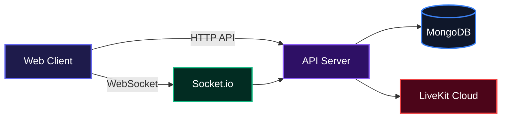
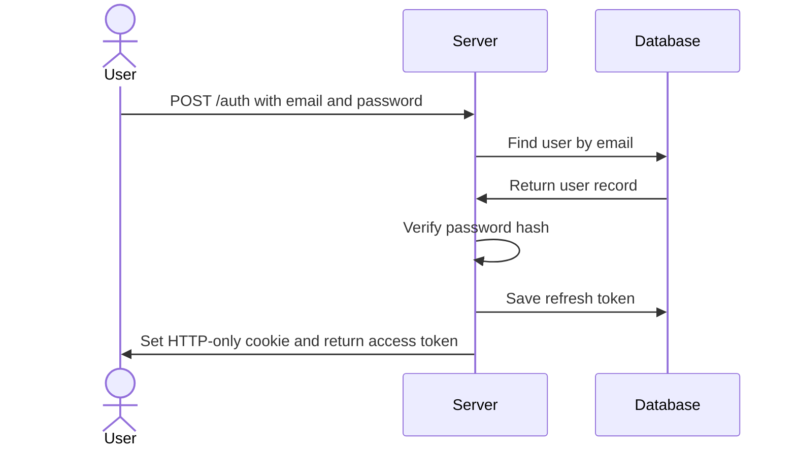
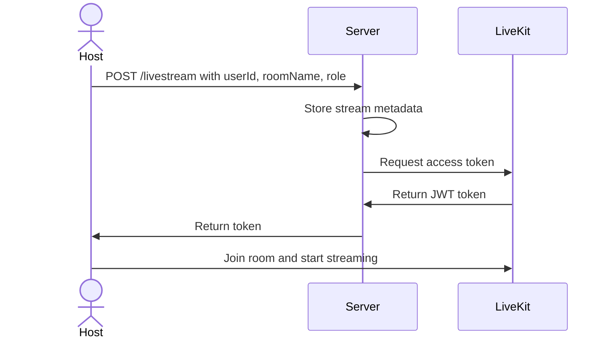

# LiveSkill Backend

LiveSkill powers the backend of a live streaming platform where creators can host real-time streams and audiences can watch, chat, and stay engaged. It handles everything from secure user accounts and JWT-based authentication to LiveKit streaming tokens and Socket.io chat rooms, all in one place.

## System Architecture



## Features

- **User Authentication**: Register and log in with bcrypt-hashed passwords and role-based JWT access tokens.
- **Token Refresh Flow**: Short-lived access tokens and long-lived refresh tokens stored in HTTP-only cookies.
- **Live Streaming**: Generate LiveKit tokens for hosts and viewers, and track active streams.
- **Real-Time Chat**: Join stream rooms, send messages, and see live viewer counts with Socket.io.
- **Email Updates**: Collect user emails for product updates or newsletters.

### Authentication Flow



### Live Streaming Flow



## Installation

1. Clone the repository:

```bash
git clone https://github.com/olusanyaemmanuelpg-sudo/Liveskill.git
cd Liveskill
```

2. Install dependencies:

```bash
npm install
```

3. Create a `.env` file in the root of the project and add your environment variables:

```bash
PORT=3000
MONGODB_URI=your_mongodb_connection_string
ACCESS_TOKEN_SECRET=your_access_token_secret
REFRESH_TOKEN_SECRET=your_refresh_token_secret
LIVEKIT_API_KEY=your_livekit_api_key
LIVEKIT_API_SECRET=your_livekit_api_secret
```

4. Start the development server:

```bash
npm run dev
```

The server will run on `http://localhost:3000` by default.

## Usage

Once the server is running, you can interact with the API using tools like cURL, Postman, or any HTTP client.

Register a new user:

```bash
curl -X POST http://localhost:3000/register \
  -H "Content-Type: application/json" \
  -d '{"user": "johndoe", "pwd": "securepassword", "email": "john@example.com"}'
```

Log in to receive an access token:

```bash
curl -X POST http://localhost:3000/auth \
  -H "Content-Type: application/json" \
  -d '{"email": "john@example.com", "pwd": "securepassword"}'
```

Create a LiveKit streaming token:

```bash
curl -X POST http://localhost:3000/livestream \
  -H "Content-Type: application/json" \
  -d '{"userId": "johndoe", "roomName": "main-stage", "role": "host", "title": "Live Coding Session"}'
```

Connect to the Socket.io server to join rooms, send messages, and receive viewer counts in real time.

## API Documentation

### Authentication

Authentication uses JWT access tokens and HTTP-only cookie refresh tokens.

- Include the access token in the `Authorization` header as `Bearer <token>` for protected routes.
- Refresh tokens are managed automatically via the `/refresh` endpoint.

### POST /register

Create a new user account.

**Request**:

```json
{
  "user": "johndoe",
  "pwd": "securepassword",
  "email": "john@example.com"
}
```

**Response**:

```json
{
  "success": "New user johndoe created"
}
```

**Errors**:

- 400: Username, email, and password are required.
- 409: A user with that username or email already exists.
- 500: Internal server error.

### POST /auth

Log in an existing user and receive a JWT access token.

**Request**:

```json
{
  "email": "john@example.com",
  "pwd": "securepassword"
}
```

**Response**:

```json
{
  "accessToken": "eyJhbGciOiJIUzI1NiIsInR5cCI6IkpXVCJ9..."
}
```

**Errors**:

- 400: Email and password are required.
- 401: Invalid credentials.

### GET /refresh

Refresh an expired access token using the refresh token stored in the HTTP-only cookie.

**Request**:

No request body required. The refresh token is read from the `jwt` cookie.

**Response**:

```json
{
  "accessToken": "eyJhbGciOiJIUzI1NiIsInR5cCI6IkpXVCJ9..."
}
```

**Errors**:

- 401: No refresh token cookie found.
- 403: Invalid or forbidden refresh token.

### GET /logout

Log out the current user by clearing the refresh token cookie and removing the token from the database.

**Request**:

No request body required. The refresh token is read from the `jwt` cookie.

**Response**:

- 204: No content.

### POST /email-update

Save a user's email to receive updates.

**Request**:

```json
{
  "emailUpdate": "john@example.com"
}
```

**Response**:

```json
{
  "success": "Thanks for choosing us"
}
```

**Errors**:

- 401: Email is required.

### POST /livestream

Generate a LiveKit access token for a stream room.

**Request**:

```json
{
  "userId": "johndoe",
  "roomName": "main-stage",
  "role": "host",
  "title": "Live Coding Session"
}
```

**Response**:

```json
{
  "token": "eyJhbGciOiJIUzI1NiIsInR5cCI6IkpXVCJ9..."
}
```

**Errors**:

- 400: userId and roomName are required.
- 500: Failed to create token.

### GET /live-streams

Fetch all currently active live streams.

**Response**:

```json
[
  {
    "roomName": "main-stage",
    "host": "johndoe",
    "title": "Live Coding Session",
    "startedAt": "2024-01-01T12:00:00.000Z"
  }
]
```

### DELETE /live-streams/:roomName

Remove a stream from the active list, typically called when the host ends the stream.

**Response**:

```json
{
  "success": true
}
```

### GET /liveskill

A protected route that tests whether the user's JWT access token is valid.

**Headers**:

```http
Authorization: Bearer <access_token>
```

**Response**:

```json
{
  "message": "You have access to a protected route!"
}
```

**Errors**:

- 401: Missing, invalid, or expired access token.

## Technologies Used

| Technology | Description |
|------------|-------------|
| [Node.js](https://nodejs.org/) | JavaScript runtime for the server |
| [Express](https://expressjs.com/) | Web framework for routing and middleware |
| [MongoDB](https://www.mongodb.com/) | NoSQL database for user and email data |
| [Mongoose](https://mongoosejs.com/) | Object modeling for MongoDB |
| [LiveKit](https://livekit.io/) | Real-time video and audio streaming infrastructure |
| [Socket.io](https://socket.io/) | Real-time bidirectional communication |
| [jsonwebtoken](https://github.com/auth0/node-jsonwebtoken) | JWT generation and verification |
| [bcrypt](https://github.com/kelektiv/node.bcrypt.js) | Password hashing |

## Contributing

Contributions are welcome. If you would like to improve this project, feel free to fork the repository, create a feature branch, and open a pull request.

## Author

- **LinkedIn**: [olusanya-emmanuel-21546536a](https://linkedin.com/in/olusanya-emmanuel-21546536a)
- **X (Twitter)**: [web_Deji_Dev](https://x.com/web_Deji_Dev)

## Badges

[](https://nodejs.org/)
[](https://expressjs.com/)
[](https://www.mongodb.com/)
[](https://socket.io/)
[](https://livekit.io/)

[](https://dokugen.samueltuoyo.com)