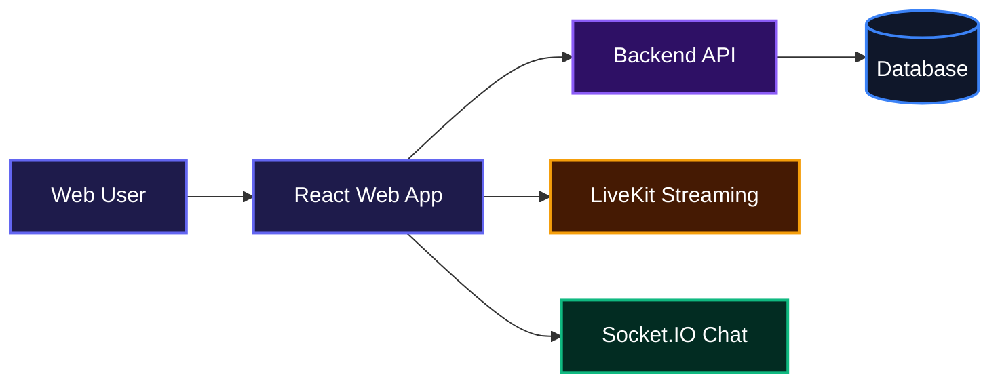
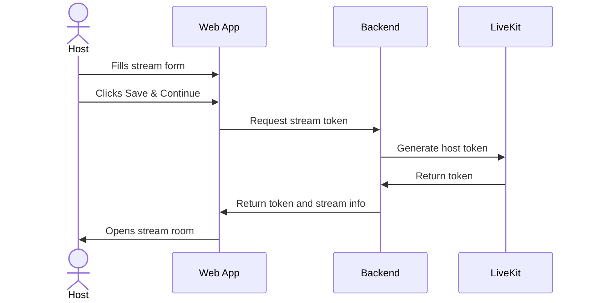
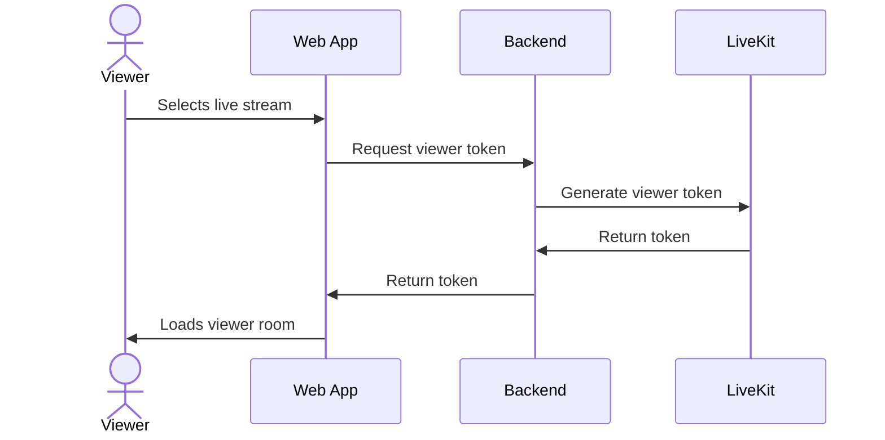
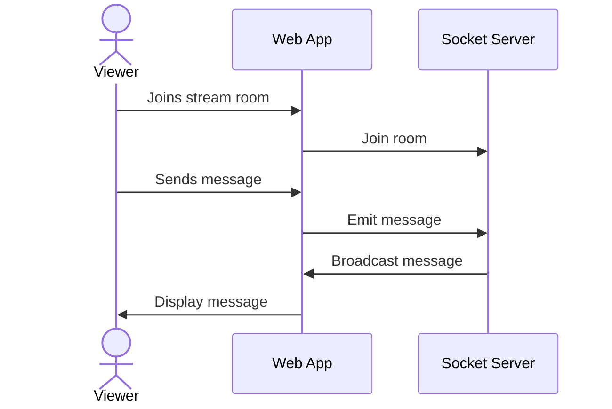

# LiveSkill

## Overview

LiveSkill is a real-time streaming platform where creators can go live, share their skills, and interact with viewers through live chat. It helps developers, educators, and hobbyists build live learning communities without a complicated setup. Users can host sessions, join ongoing streams, and chat in real time through a clean, modern interface.

## System Architecture



## Features

- **Real-Time Live Streaming**: Hosts can start live video sessions, switch cameras, and share their screens using LiveKit.
- **Live Chat**: Viewers and hosts can chat in real time through Socket.IO-powered chat rooms.
- **Stream Discovery**: Users can browse active streams and join them with one click.
- **Authentication**: Secure JWT-based login and registration with automatic access-token refresh and protected routes.

### Starting a Stream

When a creator sets up a stream, the app requests a token from the backend, connects to the streaming service, and opens the broadcaster room.



### Joining a Stream

A viewer picks a live card from the discovery page, the backend issues a viewer token, and the viewer is placed into the stream room.



### Live Chat Flow

Messages are sent through Socket.IO and broadcast to everyone in the same room, with a live viewer count.



## Installation

From the repository root, install the frontend dependencies:

```bash
cd frontend
npm install
```

Create `frontend/.env`:

```env
VITE_BACKEND_URL=http://localhost:3000
VITE_LIVEKIT_URL=wss://your-livekit-server.com
```

Start the development server from `frontend/`:

```bash
npm run dev
```

Vite prints the app URL in the terminal (normally `http://localhost:5173`). See the [root README](../README.md) for backend setup and the complete local development steps.

## Usage

After starting the app, open it in your browser. Register a new account or log in if you already have one. From the main dashboard, you can browse live streams or click the option to start your own stream. Fill in the stream title, description, category, and tags, then begin broadcasting. Viewers can click any live stream card to join and watch in real time.

## API Documentation

All endpoints are relative to the backend base URL configured in `VITE_BACKEND_URL`.

### POST /register

**Description**: Creates a new user account.

**Request**:

```json
{
  "user": "John Doe",
  "email": "john@example.com",
  "pwd": "securePassword123"
}
```

**Response**:

```json
{
  "success": true,
  "message": "User registered successfully"
}
```

**Errors**:

- 400: Invalid or missing fields.
- 409: Email or username already exists.

### POST /auth

**Description**: Authenticates a user and returns an access token.

**Request**:

```json
{
  "email": "john@example.com",
  "pwd": "securePassword123"
}
```

**Response**:

```json
{
  "accessToken": "eyJhbGciOiJIUzI1NiIsInR5cCI6IkpXVCJ9..."
}
```

**Errors**:

- 400: Missing credentials.
- 401: Invalid email or password.

### GET /refresh

**Description**: Refreshes the access token using an HTTP-only refresh-token cookie.

**Request**: Sent automatically with cookies.

**Response**:

```json
{
  "accessToken": "eyJhbGciOiJIUzI1NiIsInR5cCI6IkpXVCJ9..."
}
```

**Errors**:

- 401: Refresh token missing or invalid.

### GET /logout

**Description**: Logs the user out and clears the authentication cookies.

**Request**: Sent with credentials included.

**Response**:

```json
{
  "success": true,
  "message": "Logged out successfully"
}
```

### POST /email-update

**Description**: Subscribes an email address for platform updates.

**Request**:

```json
{
  "emailUpdate": "user@example.com"
}
```

**Response**:

```json
{
  "success": "Subscribed to updates"
}
```

**Errors**:

- 400: Invalid email format.

### GET /liveskill

**Description**: Protected route used to verify that the current user is authenticated before accessing the main dashboard.

**Request**: Requires a valid `Authorization: Bearer <token>` header.

**Response**:

```json
{
  "authenticated": true,
  "user": {
    "id": "abc123",
    "email": "john@example.com"
  }
}
```

**Errors**:

- 401: Missing or invalid access token.

### POST /livestream

**Description**: Generates a LiveKit token so a host can start a stream or a viewer can join one.

**Request**:

```json
{
  "userId": "webdeji",
  "roomName": "React for Beginners",
  "role": "host",
  "title": "React for Beginners"
}
```

**Response**:

```json
{
  "token": "eyJhbGciOiJIUzI1NiIsInR5cCI6IkpXVCJ9..."
}
```

**Errors**:

- 400: Missing required fields.
- 401: User not authenticated.
- 500: Token generation failed.

### GET /live-streams

**Description**: Returns a list of currently active streams.

**Response**:

```json
[
  {
    "roomName": "React for Beginners",
    "title": "React for Beginners",
    "host": "webdeji",
    "startedAt": "2026-08-15T10:00:00.000Z"
  }
]
```

### DELETE /live-streams/:title

**Description**: Removes a stream from the public listing when the host ends the broadcast.

**Response**:

```json
{
  "success": true,
  "message": "Stream ended"
}
```

**Errors**:

- 404: Stream not found.
- 401: User not authenticated.

## Technologies Used

| Technology | Description | Link |
| --- | --- | --- |
| React | UI library for building the interface | [react.dev](https://react.dev/) |
| Vite | Fast build tool and development server | [vitejs.dev](https://vitejs.dev/) |
| React Router | Client-side routing | [reactrouter.com](https://reactrouter.com/) |
| LiveKit Client | Real-time video and audio streaming | [livekit.io](https://livekit.io/) |
| Socket.IO Client | Real-time chat and room events | [socket.io](https://socket.io/) |
| Axios | HTTP client for API requests | [axios-http.com](https://axios-http.com/) |

## Contributing

Contributions are welcome. If you would like to improve LiveSkill, feel free to fork the repository, create a feature branch, and open a pull request. Please make sure your code follows the existing style and passes the linter before submitting.

## Author

- LinkedIn: [Olusanya Emmanuel](https://linkedin.com/in/olusanya-emmanuel-21546536a)
- X: [web_Deji_Dev](https://x.com/web_Deji_Dev)

## Badges

[](https://www.typescriptlang.org/)
[](https://react.dev/)
[](https://vitejs.dev/)
[](https://livekit.io/)
[](https://socket.io/)

[](https://dokugen.samueltuoyo.com)